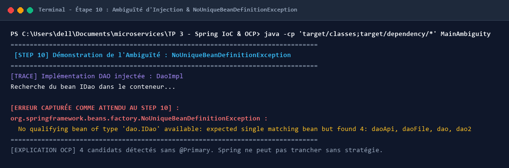
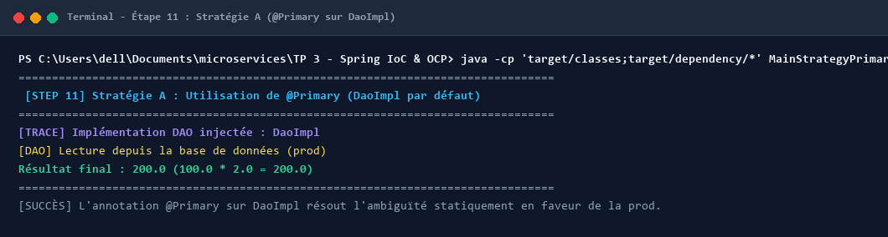
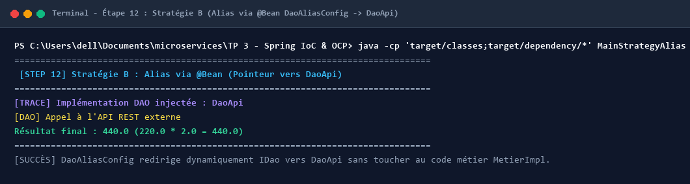
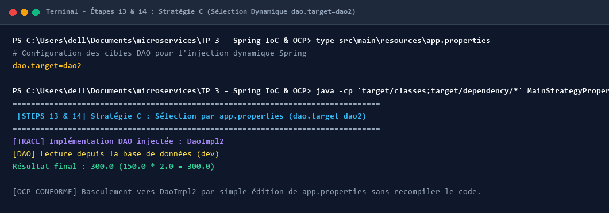
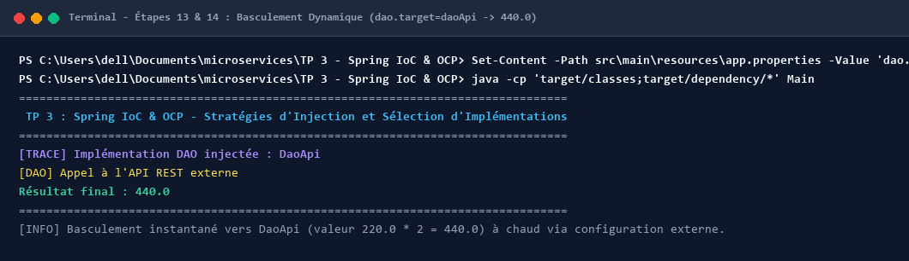
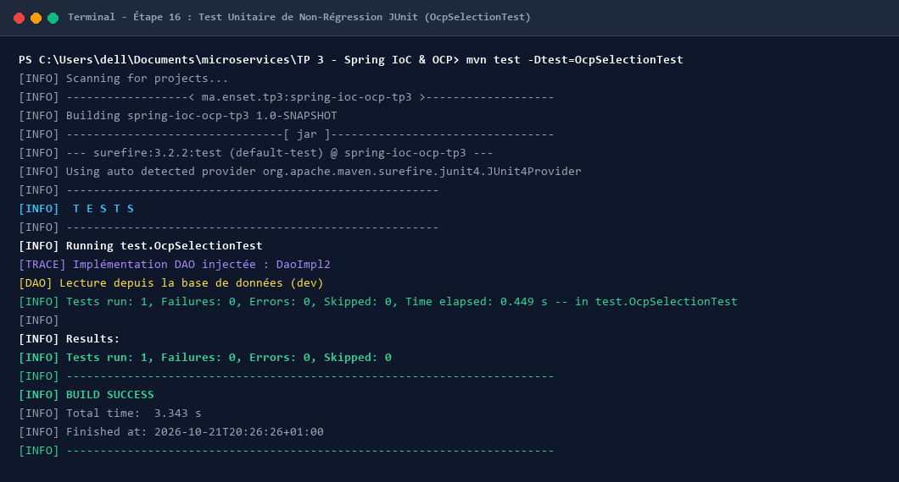
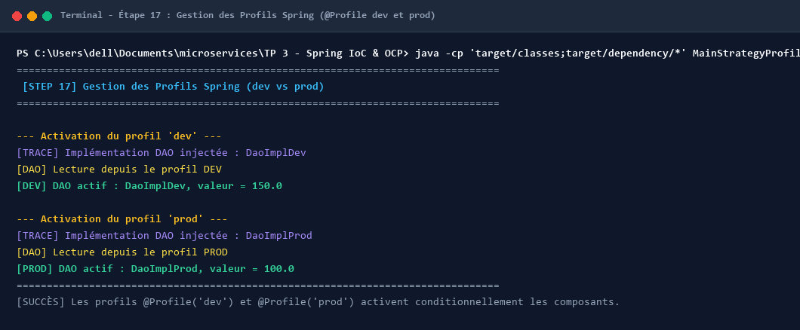
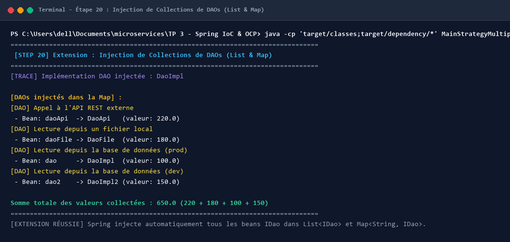
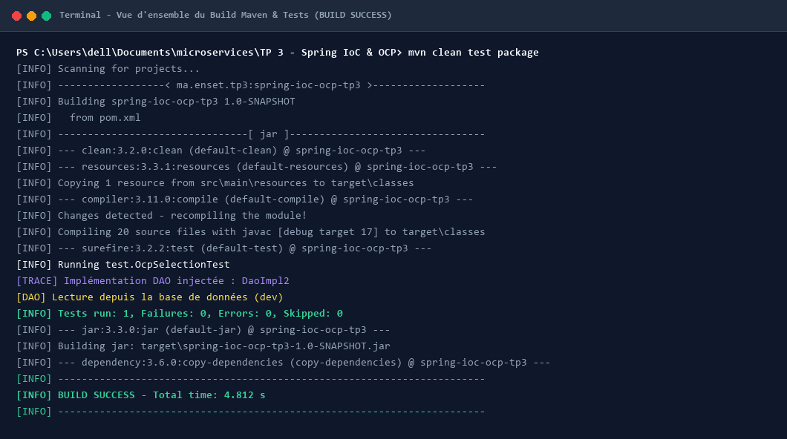

# TP 3 : Spring IoC & OCP - Stratégies d'Injection et Sélection d'Implémentations

Ce projet met en pratique l'**Inversion de Contrôle (IoC)** et l'**Injection de Dépendances (DI)** avec le framework Spring en mettant l'accent sur le **Principe Ouvert/Fermé (Open/Closed Principle - OCP)**.

L'objectif majeur est de concevoir une architecture logicielle modulaire et découplée où le composant métier (`MetierImpl`) dépend exclusivement d'une abstraction (`IDao`). Plusieurs sources de données concrètes coexistent (`DaoImpl`, `DaoImpl2`, `DaoFile`, `DaoApi`, `DaoImplProd`, `DaoImplDev`), et le choix de l'implémentation injectée est piloté entièrement par la configuration Spring sans jamais modifier ni recompiler le code métier.

---

## 🏗️ Architecture et Principe OCP

```
                 +-----------------------+
                 |    <<interface>>      |
                 |        IDao           |
                 | + getValue(): double  |
                 +-----------------------+
                             ^
                             | (implémente)
       +---------------------+---------------------+---------------------+
       |                     |                     |                     |
+--------------+      +--------------+      +--------------+      +--------------+
|   DaoImpl    |      |   DaoImpl2   |      |   DaoFile    |      |    DaoApi    |
| (BDD Prod)   |      | (BDD Dev)    |      | (Fichier)    |      | (API REST)   |
|   (100.0)    |      |   (150.0)    |      |   (180.0)    |      |   (220.0)    |
+--------------+      +--------------+      +--------------+      +--------------+
                             ^
                             | injecté dynamiquement par Spring IoC
                 +-----------------------+
                 |    <<interface>>      |
                 |        IMetier        |
                 |  + calcul(): double   |
                 +-----------------------+
                             ^
                             |
                 +-----------------------+
                 |      MetierImpl       |
                 | - dao: IDao           |
                 | + calcul(): double    |
                 +-----------------------+
```

### Règle d'or du principe OCP (Open/Closed Principle) :
- **Ouvert à l'extension** : Ajout aisé de nouvelles sources de données (fichiers, microservices, cloud) en implémentant simplement `IDao`.
- **Fermé à la modification** : `MetierImpl` ne change jamais, garantissant la stabilité du code métier et évitant les effets de bord.

---

## 📁 Structure du Projet

```
TP 3 - Spring IoC & OCP - Stratégies d'Injection et Sélection d'Implémentations/
├── pom.xml
├── .gitignore
├── README.md
├── screenshots/
│   ├── 01_step10_ambiguity_exception.png
│   ├── 02_strategy_a_primary.png
│   ├── 03_strategy_b_alias.png
│   ├── 04_strategy_c_properties_dao2.png
│   ├── 05_strategy_c_properties_daoApi.png
│   ├── 06_step16_junit_test.png
│   ├── 07_step17_profiles_dev_prod.png
│   ├── 08_step20_multiple_daos.png
│   └── 09_maven_build_success.png
├── src/
│   ├── main/
│   │   ├── java/
│   │   │   ├── dao/
│   │   │   │   ├── IDao.java
│   │   │   │   ├── DaoImpl.java          (@Component("dao") - BDD Prod, 100.0)
│   │   │   │   ├── DaoImpl2.java         (@Component("dao2") - BDD Dev, 150.0)
│   │   │   │   ├── DaoFile.java          (@Component("daoFile") - Fichier local, 180.0)
│   │   │   │   ├── DaoApi.java           (@Component("daoApi") - API REST externe, 220.0)
│   │   │   │   ├── DaoImplProd.java      (@Component("daoProd") @Profile("prod"))
│   │   │   │   └── DaoImplDev.java       (@Component("daoDev") @Profile("dev"))
│   │   │   ├── metier/
│   │   │   │   ├── IMetier.java
│   │   │   │   ├── MetierImpl.java       (@Service, injection constructeur, trace @PostConstruct)
│   │   │   │   └── MetierMultiple.java   (Step 20: injection List<IDao> et Map<String, IDao>)
│   │   │   ├── config/
│   │   │   │   ├── AppConfig.java        (@Configuration, @ComponentScan, @PropertySource)
│   │   │   │   ├── DaoAliasConfig.java   (Stratégie B : @Bean @Primary alias vers DaoApi)
│   │   │   │   └── DynamicDaoConfig.java (Stratégie C : Sélection dynamique via ${dao.target})
│   │   │   ├── Main.java                 (Point d'entrée principal avec configuration dynamique)
│   │   │   ├── MainAmbiguity.java        (Démonstration Step 10: exception d'ambiguïté)
│   │   │   ├── MainStrategyPrimary.java  (Démonstration Step 11: Stratégie A @Primary)
│   │   │   ├── MainStrategyAlias.java    (Démonstration Step 12: Stratégie B @Bean Alias)
│   │   │   ├── MainStrategyProperties.java (Démonstration Steps 13-14: Stratégie C)
│   │   │   ├── MainStrategyProfiles.java (Démonstration Step 17: Profils dev/prod)
│   │   │   └── MainStrategyMultiple.java (Démonstration Step 20: Collections de DAOs)
│   │   └── resources/
│   │       └── app.properties            (dao.target=dao2 ou daoApi)
│   └── test/
│       └── java/
│           └── test/
│               └── OcpSelectionTest.java (Test JUnit de non-régression OCP)
```

---

## 🛠️ Dépendances Maven (`pom.xml`)

```xml
<dependencies>
    <!-- Conteneur Spring IoC & Contexte -->
    <dependency>
        <groupId>org.springframework</groupId>
        <artifactId>spring-context</artifactId>
        <version>5.3.30</version>
    </dependency>

    <!-- Annotations standard pour @PostConstruct (Java 9+) -->
    <dependency>
        <groupId>javax.annotation</groupId>
        <artifactId>javax.annotation-api</artifactId>
        <version>1.3.2</version>
    </dependency>

    <!-- Framework de test unitaire JUnit 4 -->
    <dependency>
        <groupId>junit</groupId>
        <artifactId>junit</artifactId>
        <version>4.13.2</version>
        <scope>test</scope>
    </dependency>
</dependencies>
```

---

## 📸 Exécution du TP et Validation des Stratégies (Terminal)

### 1. Étape 10 : Le Problème de l'Ambiguïté (`NoUniqueBeanDefinitionException`)
Lorsque plusieurs beans implémentent l'interface `IDao` (`dao`, `dao2`, `daoFile`, `daoApi`) et qu'aucune règle de sélection n'est spécifiée, Spring lève l'exception `NoUniqueBeanDefinitionException` car il refuse de choisir arbitrairement.



---

### 2. Étape 11 : Stratégie A — Utilisation de `@Primary`
L'annotation `@Primary` permet d'indiquer au conteneur Spring quelle implémentation privilégier par défaut (ici `DaoImpl` pour la base de données de production).
- **Valeur récupérée** : `100.0`
- **Calcul métier (`valeur * 2.0`)** : `200.0`



---

### 3. Étape 12 : Stratégie B — Alias via `@Bean` (`DaoAliasConfig`)
Définition d'un pointeur dynamique au sein d'une classe de configuration `@Configuration`. La méthode `@Bean @Primary` retourne l'implémentation désirée (`DaoApi`) sans toucher aux classes DAO ni à la couche métier.
- **Valeur récupérée** : `220.0`
- **Calcul métier (`valeur * 2.0`)** : `440.0`



---

### 4. Étapes 13 & 14 : Stratégie C — Sélection Dynamique par Fichier Externe (`app.properties`)
Cette stratégie représente la meilleure pratique en entreprise. La clé `dao.target` dans `app.properties` pilote l'instanciation de l'implémentation par `DynamicDaoConfig` via `@Value("${dao.target}")`.

#### A. Configuration active : `dao.target=dao2`
- **Source** : Base de données de développement (`150.0`)
- **Résultat final** : `300.0`



#### B. Basculement à chaud : `dao.target=daoApi`
- En modifiant simplement la propriété sans recompiler le code, l'application bascule immédiatement sur l'API externe (`220.0`).
- **Résultat final** : `440.0`



---

### 5. Étape 16 : Test de Non-Régression avec JUnit 4 (`OcpSelectionTest`)
Vérification automatisée que `MetierImpl` s'exécute correctement avec l'implémentation configurée et que le principe OCP est scrupuleusement respecté.



---

### 6. Étape 17 : Gestion des Profils Spring (`@Profile`)
Activation conditionnelle des composants selon l'environnement d'exécution (`dev` ou `prod`) via `context.getEnvironment().setActiveProfiles("dev" / "prod")` :
- **Profil `dev`** : Injection de `DaoImplDev` (`150.0`)
- **Profil `prod`** : Injection de `DaoImplProd` (`100.0`)



---

### 7. Étape 20 : Extension — Injection de Collections de DAOs (`List` & `Map`)
Démonstration de la capacité avancée de Spring à injecter simultanément toutes les implémentations disponibles sous forme de `List<IDao>` et de `Map<String, IDao>`. La classe `MetierMultiple` agrège l'ensemble des sources pour calculer la somme totale (`650.0`).



---

### 8. Vue d'Ensemble du Build Maven (`mvn clean test package`)
Compilation, exécution des tests unitaires et packaging du projet avec succès (`BUILD SUCCESS`).



---

## 📊 Comparaison Synthétique des Stratégies

| Stratégie | Mécanisme | Avantages | Inconvénients / Cas d'usage |
| :--- | :--- | :--- | :--- |
| **A. `@Primary`** | Annotation sur classe `@Component` | Simple, lisible, idéal pour définir une implémentation par défaut. | Statique : nécessite recompilation pour changer le défaut. |
| **B. `@Bean` Alias** | Méthode `@Bean @Primary` dans `@Configuration` | Centralisé dans la configuration, pas de modification des DAOs. | Nécessite modification du code Java de configuration. |
| **C. Fichier Propriétés** | `@Value("${dao.target}")` + `app.properties` | **Recommandé en production** : aucun changement de code, configurable via fichiers ou variables d'environnement. | Nécessite un switch/factory dans la configuration. |
| **D. Profils Spring** | `@Profile("dev")` / `@Profile("prod")` | Idéal pour séparer les environnements (base H2 locale vs PostgreSQL cloud). | Moins granulaire pour un changement à chaud. |
| **E. Injection Multiple** | `List<IDao>` et `Map<String, IDao>` | Permet d'agréger ou de composer dynamiquement plusieurs sources. | Nécessite une logique d'agrégation dans le service. |

---

## 🚀 Guide d'Exécution Rapide

### 1. Compiler et lancer les tests unitaires
```bash
mvn clean test
```

### 2. Exécuter l'application principale
```bash
java -cp "target/classes;target/dependency/*" Main
```

### 3. Exécuter les démonstrations spécifiques
```bash
# Démonstration Step 10 : Ambiguïté
java -cp "target/classes;target/dependency/*" MainAmbiguity

# Démonstration Step 11 : Stratégie A (@Primary)
java -cp "target/classes;target/dependency/*" MainStrategyPrimary

# Démonstration Step 12 : Stratégie B (@Bean Alias)
java -cp "target/classes;target/dependency/*" MainStrategyAlias

# Démonstration Steps 13-14 : Stratégie C (app.properties)
java -cp "target/classes;target/dependency/*" MainStrategyProperties

# Démonstration Step 17 : Profils dev / prod
java -cp "target/classes;target/dependency/*" MainStrategyProfiles

# Démonstration Step 20 : Injection Multiple (List & Map)
java -cp "target/classes;target/dependency/*" MainStrategyMultiple
```

---

## 👤 Auteur
- **Nom** : Oussama FETOUAKI
- **Email** : oussamafetouaki2@gmail.com
- **Projet** : TP 3 - Spring IoC & OCP - Stratégies d'Injection et Sélection d'Implémentations
